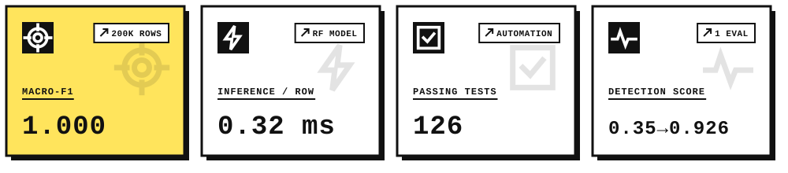
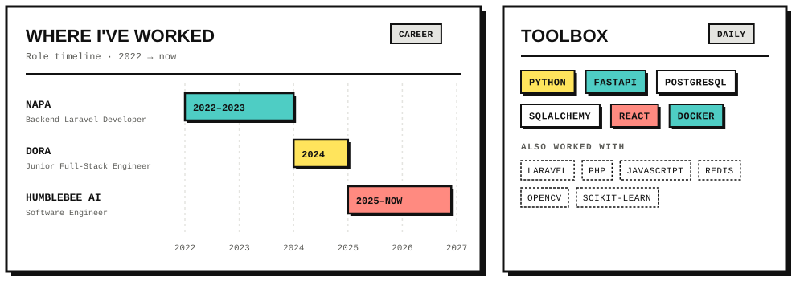

I started learning web development through **IT Park Uzbekistan**. One of my first applications took me into a hackathon, and that experience helped lead to my first commercial backend role in 2022.

Since then I've moved from Laravel/PHP applications into Python backend engineering, authentication, databases, automation, computer vision and applied machine learning. The technology changed; the mindset didn't: **understand the system, measure the problem, ship a reliable fix.**

**[`EMAIL`](mailto:otabekovasadbek6@gmail.com)** &nbsp;·&nbsp; **[`LINKEDIN`](https://www.linkedin.com/in/asadbek-otabekov-b50404242/)** &nbsp;·&nbsp; **[`REPOSITORIES`](https://github.com/asadbek2006y?tab=repositories)**

