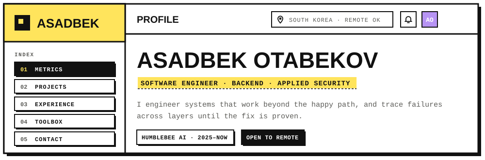
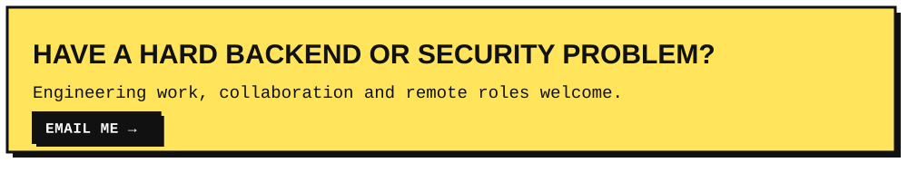

I build backend systems, detection and scoring pipelines, and the products on top of them, mostly in Python and TypeScript, with Rust for detection. I work beyond the happy path: understand the system, measure it, fix it, and prove the fix.

Right now I'm a maintainer on **[RedTeam Subnet](https://www.theredteam.io/)** (Bittensor subnet 61) at HumbleBee AI, working on bot and browser detection, the scoring behind it, and the portal around it.

### Security and detection · RedTeam Subnet · Jul 2026 – now

- **Passive OS fingerprinting.** A Random Forest on TCP-level features: 1.000 macro-F1 on the challenge's 200,000-row check, at 0.32 ms per row. [Challenge docs](https://docs.theredteam.io/latest/challenges/flowprint/)
- **Automation detection.** Detectors for 9 browser automation frameworks, plus fixes for a harness crash and zero-score bugs. Passes the official validator. [Challenge docs](https://docs.theredteam.io/latest/challenges/ab_sniffer/)
- **Bot-detection challenge.** Took a solution's score from 0.35 to 0.968, then about 0.984 across later runs. [Challenge repo](https://github.com/RedTeamSubnet/bot-virus-challenge)
- **Scoring hardening.** Integrating a Rust detector into a challenge's scoring, failing closed when the detector errors. In review.
- **Portal performance.** The public dashboard went from a 2.3 MB page to 0.76 MB, and its data API from 24 ms to 5 ms, through build-once data, ETags, caching and lazy-loaded charts. [Dashboard](https://www.theredteam.io/dashboard/)
- **Self-hosted support agent.** Ollama and Google ADK, with fail-closed answer routing, admin RBAC with TOTP, a hash-chained audit log and a kill switch. 838 tests; backup, restore and rollback drills.

### Backend platform · internal HR and productivity system · Apr – Jul 2026

- **Session reliability.** Replaced a non-atomically updated refresh-token column with per-session slots and row locks (`SELECT … FOR UPDATE`), and fixed a 401 → refresh → 500 loop across frontend and backend. 19 regression and integration tests.
- **Project-cost dashboard.** Metrics API, billable flags, Excel import and export.
- **Discord HR status bot.** Backfill, restart safety and per-server config. 126 tests.

### Computer vision and AI products · Nov 2025 – Aug 2026

- **Smart-office analytics.** Replaced an aiortc prototype with an RTSP → LiveKit pipeline (two cameras at 27–30 fps), built zone and room management across tenant schemas, and projected people onto floor plans in real time with homography.
- **AI marketing-video app.** Template and multi-segment editors, version history, avatar and voice-clone onboarding, and an Instagram import that uses Gemini to extract the script, shipped to production.

### Own projects

- **[Kashshof](https://github.com/asadbek2006y/kashshof)**: capstone prototype of a support finder for women and families in Uzbekistan. Rule-based matching that explains every result, and programs taken from public sources with a link for each. Next.js, NestJS, Prisma, PostgreSQL; Uzbek, Russian and English.
- **[Lobbi](https://yourlobbi.com)**: web app in React and TypeScript. I built the landing page and the phone sign-in screens.

| Company | Role | Years |
|---|---|---|
| **HumbleBee AI** | Software Engineer | 2025 – now |
| **DORA** | Junior Full-Stack Engineer | 2024 |
| **NAPA Automotive** | Backend Laravel Developer | 2022 – 2023 |

**Daily:** Python · FastAPI · PostgreSQL · SQLAlchemy · React · TypeScript · Docker 
**Also:** Rust · Redis · OpenCV · LiveKit · scikit-learn · Playwright · Google ADK · Ollama · Laravel · PHP

I started learning web development through **IT Park Uzbekistan**. One of my first applications took me into a hackathon, and that helped lead to my first commercial backend role in 2022.

Since then I've moved from Laravel/PHP into Python backend engineering, authentication, databases, computer vision, applied machine learning and detection. I'm also studying at Sejong University in Seoul.

**[`EMAIL`](mailto:otabekovasadbek6@gmail.com)** &nbsp;·&nbsp; **[`LINKEDIN`](https://www.linkedin.com/in/asadbek-otabekov-b50404242/)**

